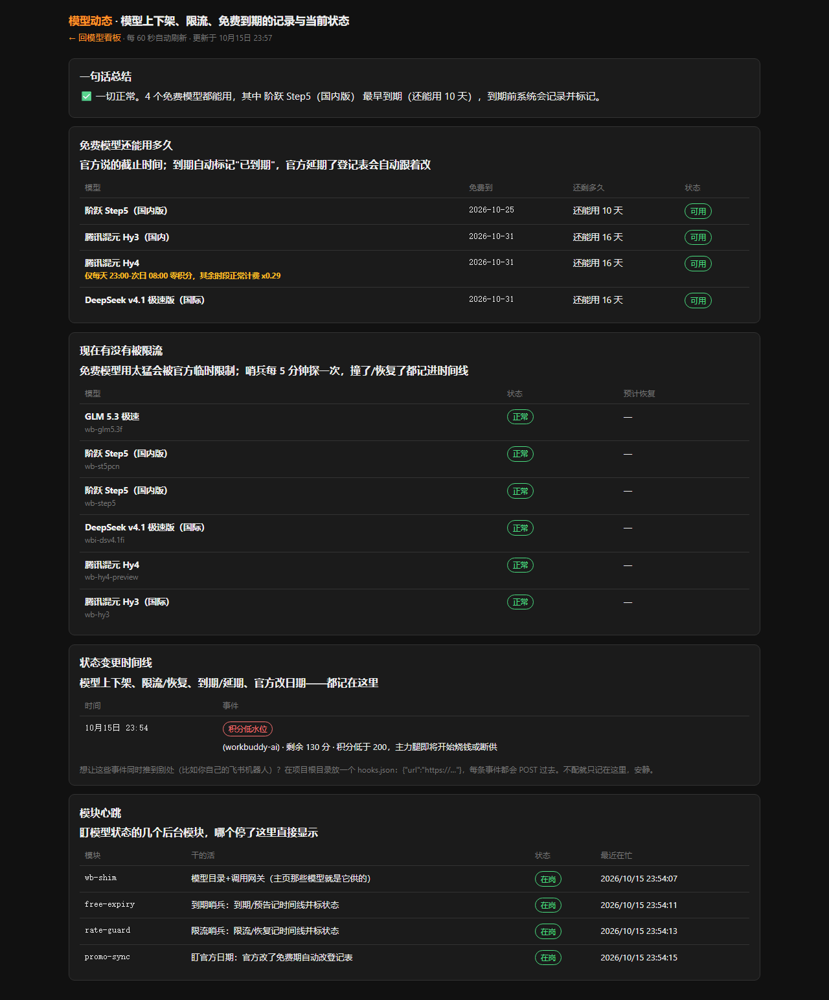

# wb-shim

把 **WorkBuddy 的模型和积分**变成自己人能随便用的本地服务：一个常驻网关（OpenAI 兼容协议），加上一套"主页模型信息永远准确及时"的自动化哨兵。

> 独立项目 · 单机部署 · 无外部依赖服务（除 WorkBuddy 账号本身）

## 它解决什么问题

WorkBuddy 官方客户端里有一堆模型（含限免的），但只有客户端能用。wb-shim 做三件事：

1. **模型出墙**：把 WorkBuddy 模型包装成标准 OpenAI 接口，挂在固定端口上。任何支持 OpenAI 协议的客户端/LiteLLM 都能拿它当上游——引擎、工具链一行不改，只换模型。
2. **积分看账**：官方账页只有个总数，wb-shim 把官方计费接口拆开做了自己的明细页——每天谁在烧、烧在哪个模型上、每笔请求多少积分，一眼看到底。
3. **模型动态**（份内自动化，2026-10-15 定位收窄）：维护主页模型信息的**准确和及时**——模型上架/下架、被限流/恢复、限免到期/官方延期，全部自动探测、记进状态时间线、在页面上标状态徽章。

> 定位铁律：wb-shim 只做份内的事。通知怎么发、下游网关怎么改配置、bot 怎么调度，都是使用者自己的事——本项目只负责把模型状态说准。需要推送？配一个 `hooks.json`（见下），每条状态变更都会 POST 给你自己的接收端。

## 组成

| 文件 | 干什么 |
|---|---|
| `daemon.mjs` | 主服务。固定端口常驻 OpenAI 兼容端点 + 模型目录管理（上下架自动记时间线）+ 积分余额监控 + 用量明细页 + 状态徽章渲染。核心逻辑是把官方客户端插件（dsh-workbuddy-connect@0.7.1）的组装流程复刻出来，凭据加密钥匙从插件的分块文件里按名导入——**插件版本锁死 0.7.1，升级要核对分块文件名** |
| `proto-convert.mjs` | 协议转换层。Anthropic Messages / OpenAI Responses 两种协议转成上游只认的 chat/completions，回程再转回来。按路径分流，不按模型分流 |
| `events.mjs` | 模型状态时间线（唯一事件出口）：所有自动化动作统一记一条 JSONL 事件，可选 webhook 推送 |
| `rate-guard.mjs` | 限流哨兵：每 5 分钟直探上游（max_tokens=1），撞限流/连续超时挂死 → 记事件 + 状态落盘（首页徽章"限流中"）；到重置时间自动探测恢复 |
| `free-expiry.mjs` | 到期哨兵：每 5 分钟盘到期登记表，3 天/1 天/6 小时水位预告、到期记事件 + 标"已到期"；官方延期自动解除标记 |
| `promo-sync.mjs` | 官方促销同步：读 WorkBuddy 客户端缓存的官方产品配置（权威到期时间只写在界面里，API 不返回），每 30 分钟对账登记表 |
| `usage-log.mjs` | 用量与限流记账：官方不公开限流配额，反代自己记每次请求的 usage，倒推还能用多少 |

## HTTP 端点

| 端点 | 说明 |
|---|---|
| `POST /v1/chat/completions` | OpenAI 兼容主入口，按模型路由到对应上游 |
| `POST /v1/messages` | Anthropic Messages 协议（自动转换） |
| `POST /v1/responses` | OpenAI Responses 协议（自动转换） |
| `GET /healthz` | 免鉴权探活 |
| `GET /alerts` | 免鉴权只读：各版积分/用量/免费名单/告警 + 最近 30 条状态事件 |
| `GET /api/router` | 模型动态页数据接口（状态总览/时间线/心跳） |
| `GET /usage?date=YYYY-MM-DD` | 按日汇总 + 明细页（带翻页） |
| `GET /usage-detail?date=` | 按模型聚合的明细 JSON |

默认端口 `18796`，可用环境变量改：`WB_SHIM_PORT` / `WB_SHIM_HOST` / `WB_SHIM_REFRESH_MS` / `WB_SHIM_CATALOG_MAX_AGE_MS` / `WB_SHIM_CREDITS_ALERT_BELOW`。

## 性能设计

- **缓存三级**：内存 60s TTL（仅今天）→ 磁盘缓存（历史日期永久）→ 官方接口。重启后查历史 0.1 秒。
- **单飞**：同一天并发查询只打一次官方接口，其余等结果——看板/告警/明细页撞车不重复烧请求。
- **启动预取**：后台自动拉最近 7 天账单落盘。

## 通知钩子（可选）

在项目根目录放 `hooks.json`（已 gitignore，不会入库）：

```json
{ "url": "https://你的接收端/webhook", "secret": "可选，随事件头 X-WB-Shim-Secret 一起发" }
```

配了之后，每条状态事件（模型上下架/限流恢复/到期延期/官方改日期/积分低水位）都会 POST 一份 JSON 过去；不配就只落盘到 `events.jsonl`，完全安静。事件类型：`model-added` / `model-removed` / `rate-limited` / `rate-recovered` / `model-expired` / `expiry-extended` / `expiry-notice` / `promo-update` / `credits-low`。

## 界面截图

首页（模型目录：积分余量 / 模型倍率 / 上下文 / 调用 ID / 限流与到期状态徽章）：


积分明细页（`/usage`：官方账按模型聚合，可翻历史日期）：


模型动态页（`/router`：模型状态总览 / 状态变更时间线 / 各哨兵模块心跳）：



## 不入库的文件（已 gitignore）

`token.txt`、`hooks.json`、`events.jsonl`、`free-expiry.json`、`rate-guard.json`、各 `.*-state.json`、`logs/` ——凭据和运行状态只留本地，拿到项目的人自己填自己的。

## 运行

```bash
pnpm install
node daemon.mjs          # 主服务
node rate-guard.mjs      # 限流哨兵
node free-expiry.mjs     # 到期哨兵
node promo-sync.mjs      # 官方促销同步（读 WorkBuddy 客户端缓存）
```

生产环境用 nssm 注册成 Windows 服务常驻。

## 依赖

- Node.js ≥ 20（ESM、顶层 await）
- `dsh-workbuddy-connect@0.7.1`（版本锁死，见 daemon.mjs 头注释）
