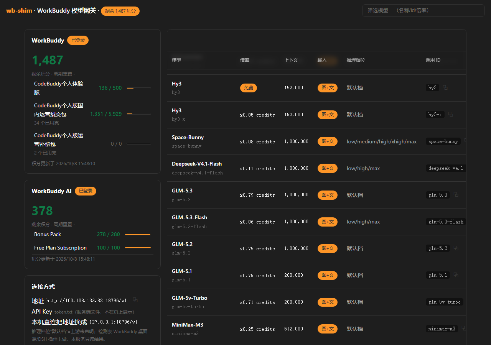
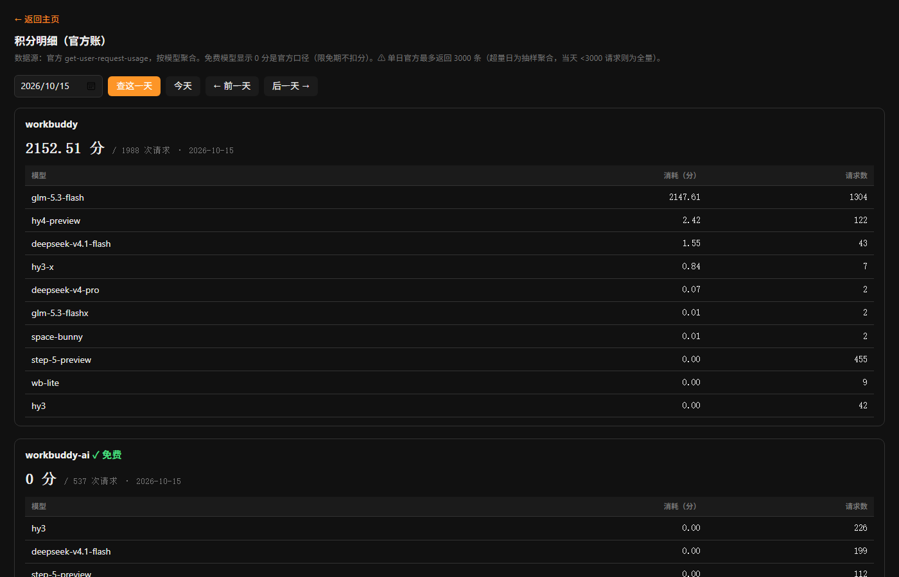

# wb-shim

把 **WorkBuddy 的模型和积分**变成自己人能随便用的本地服务：一个常驻网关（OpenAI 兼容协议），加上一套"积分别白烧、限免别错过"的管家系统。

> 私有项目 · 单机部署 · 无外部依赖服务（除 WorkBuddy 账号本身）

## 它解决什么问题

WorkBuddy 官方客户端里有一堆模型（含限免的），但只有客户端能用。wb-shim 做三件事：

1. **模型出墙**：把 WorkBuddy 模型包装成标准 OpenAI 接口，挂在固定端口上。LiteLLM 拿它当上游，下游十几个 AI bot 全部用上 WorkBuddy 的模型——引擎、工具链一行不改，只换模型。
2. **积分看账**：官方账页只有个总数，wb-shim 把官方计费接口拆开做了自己的明细页——每天谁在烧、烧在哪个模型上、每笔请求多少积分，一眼看到底。
3. **白嫖管家**：限免模型快到期了提前私聊提醒；官方偷偷延期自动同步进来（官方延期只写在界面里，API 不返回）；免费模型被限流了自动给挂它最多的 bot 换道，不硬撞。

## 组成

| 文件 | 干什么 |
|---|---|
| `daemon.mjs` | 主服务。固定端口常驻 OpenAI 兼容端点 + 模型目录管理 + 积分余额监控 + 用量明细页。核心逻辑是把官方客户端插件（dsh-workbuddy-connect@0.7.1）的组装流程复刻出来，凭据加密钥匙从插件的分块文件里按名导入——**插件版本锁死 0.7.1，升级要核对分块文件名** |
| `proto-convert.mjs` | 协议转换层。Anthropic Messages / OpenAI Responses 两种协议转成上游只认的 chat/completions，回程再转回来。按路径分流，不按模型分流 |
| `free-expiry.mjs` | 限免到期管理：到期前 N 天/时/分私聊提醒（人话格式：谁到期、几号、影响谁、打算怎么处理） |
| `promo-sync.mjs` | 官方促销/限免信息自动同步，治"官方延期读不到"的缺口 |
| `rate-guard.mjs` | 限流感知自动重排：限流按「账号+模型」维度算，挂的 bot 越多撞得越快——记账、预测、提前换道 |
| `usage-log.mjs` | 用量与限流记账：官方不公开限流配额，反代自己记每次请求的 usage，倒推还能用多少 |
| `alert-push.mjs` | 告警推送：独立进程轮询 `/alerts`，有新告警就用 bot 身份私聊推人。跟主服务分开跑，主服务崩了推送不断 |
| `notify-log.mjs` | 所有飞书通知的落盘历史（谁、何时、发了什么），JSONL 追加 |

## HTTP 端点

| 端点 | 说明 |
|---|---|
| `POST /v1/chat/completions` | OpenAI 兼容主入口，按模型路由到对应上游 |
| `POST /v1/messages` | Anthropic Messages 协议（自动转换） |
| `POST /v1/responses` | OpenAI Responses 协议（自动转换） |
| `GET /healthz` | 免鉴权探活 |
| `GET /alerts` | 免鉴权只读：限免到期 / 积分低水位 / 新限免上线 |
| `GET /usage?date=YYYY-MM-DD` | 按日汇总 + 明细页（带翻页） |
| `GET /usage-detail?date=` | 按模型聚合的明细 JSON |

默认端口 `18796`，可用环境变量改：`WB_SHIM_PORT` / `WB_SHIM_HOST` / `WB_SHIM_REFRESH_MS` / `WB_SHIM_CATALOG_MAX_AGE_MS` / `WB_SHIM_CREDITS_ALERT_BELOW`。

## 性能设计

- **缓存三级**：内存 60s TTL（仅今天）→ 磁盘缓存（历史日期永久）→ 官方接口。重启后查历史 0.1 秒。
- **单飞**：同一天并发查询只打一次官方接口，其余等结果——看板/告警/明细页撞车不重复烧请求。
- **启动预取**：后台自动拉最近 7 天账单落盘。

## 界面截图

首页（模型目录：积分余量 / 模型倍率 / 上下文 / 调用 ID）：



积分明细页（`/usage`：官方账按模型聚合，可翻历史日期）：



## 不入库的文件（已 gitignore）

`token.txt`、`lark-secret.txt`、`free-expiry.json`、`rate-guard.json`、`logs/` ——凭据和运行状态只留本地。

## 运行

```bash
pnpm install
node daemon.mjs          # 主服务
node alert-push.mjs      # 告警推送（可选，独立进程）
```

生产环境用 nssm 注册成 Windows 服务常驻。

## 依赖

- Node.js ≥ 20（ESM、顶层 await）
- `dsh-workbuddy-connect@0.7.1`（版本锁死，见 daemon.mjs 头注释）
